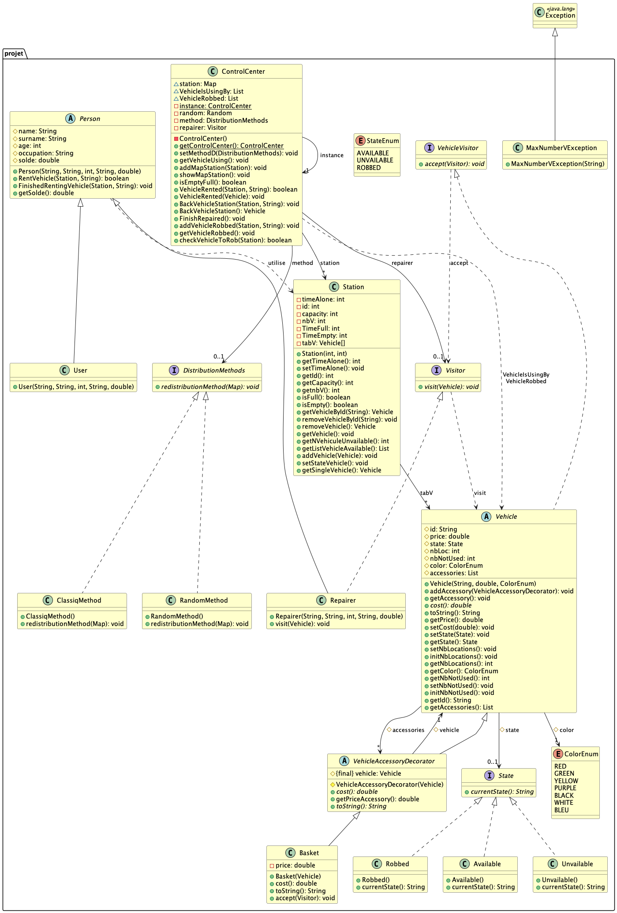

# Projet : gestion d'un parc de véhicules en libre-service
 
## 1. Présentation

**Binôme :**

- Matheo Georges

Ce projet Java simule un système de **location de véhicules en libre-service** (type vélos ou trottinettes en station).

Le programme gère :

- des **stations** de capacité limitée, dans lesquelles on dépose et on récupère des véhicules ;
- des **véhicules** de différentes couleurs, auxquels on peut ajouter des accessoires (par exemple un panier) ;
- des **utilisateurs** qui louent et rendent des véhicules, et des **réparateurs** qui remettent en état les véhicules abîmés ;
- un **centre de contrôle** qui supervise l'ensemble : véhicules en cours d'utilisation, véhicules volés, et **redistribution** des véhicules entre les stations selon une méthode choisie.

Le code est organisé dans le package `projet`.

---
## 2. HowTo

> Prérequis : Java (JDK) et Maven installés (`java -version`, `mvn -version`).

### 2.1 Récupérer les sources

Dans un terminal :

```bash
mkdir [Nom_Dossier]
cd [Nom_Dossier]
git clone https://gitlab-etu.fil.univ-lille.fr/matheo.georges.etu/projetcoo
```

Se placer ensuite dans le dossier du projet Maven (celui qui contient le `pom.xml`). **Toutes les commandes suivantes s'exécutent depuis ce dossier :**

```bash
cd projetcoo/test
```

### 2.2 Structure du projet

```
projetcoo/test/
├── pom.xml
├── src/main/java/projet/    # sources
├── src/test/java/projet/    # tests
└── target/                  # fichiers générés (compilation, jar)
```

### 2.3 Générer la documentation

```bash
javadoc -d doc -sourcepath src/main/java -subpackages projet
```

La documentation est générée dans le dossier **`doc/`**. Ouvrir `doc/index.html` dans un navigateur.
Pour ouvrir la documentation, tapez : `open doc/index.html` (Mac) | start `doc\index.html` (Windows)

### 2.4 Compiler et exécuter les sources

```bash
mvn compile
java -cp target/classes projet.App
```

### 2.5 Compiler et exécuter les tests

```bash
mvn test
```

### 2.6 Générer et exécuter l'archive `.jar`

```bash
mvn compile
jar cfe projet.jar projet.App -C target/classes .
java -jar projet.jar
```

---

## 3. Éléments de code

### 3.1 Vue d'ensemble de la conception

Le diagramme de classes complet est fourni dans `diagramme.png` (source : `diagramme.puml`).



Le projet s'appuie sur plusieurs **patrons de conception** et sur d'autres principes vus en cours.

### 3.2 Patrons de conception utilisés

| Patron | Classes concernées | Rôle |
|---|---|---|
| **Singleton** | `ControlCenter` | Une seule instance du centre de contrôle dans tout le programme (constructeur privé, accès via `getControlCenter()`). |
| **Decorator** | `Vehicle`, `VehicleAccessoryDecorator`, `Basket` | Ajoute des accessoires à un véhicule (et leur coût) sans modifier la classe `Vehicle` ni créer une sous-classe par combinaison. |
| **Visitor** | `Visitor`, `VehicleVisitor`, `Repairer` | Permet à un réparateur d'agir sur un véhicule (`visit(Vehicle)`) sans que le véhicule connaisse le détail de la réparation. |
| **State** | `State`, `Available`, `Unvailable`, `Robbed` | L'état d'un véhicule (disponible, indisponible, volé) est un objet : `currentState()` change de comportement selon l'état. |
| **Strategy** | `DistributionMethods`, `ClassiqMethod`, `RandomMethod` | La méthode de redistribution des véhicules entre stations est interchangeable à l'exécution (`setMethodD`). |

### 3.3 Autres choix de conception

- **Classes abstraites** : `Person` (factorise nom, prénom, âge, profession, solde) est spécialisée en `User` et `Repairer` ; `Vehicle` impose la méthode `cost()`.
- **Énumérations** : `ColorEnum` (couleurs des véhicules) et `StateEnum` (états possibles) évitent les chaînes de caractères et permettent de définir un ensemble de valeurs possibles.
- **Exception personnalisée** : `MaxNumberVException` signale le dépassement du nombre maximal de véhicules pour une station.
- **Encapsulation** : les attributs sont `private` ou `protected`, l'accès se fait par des getters/setters en dehors des classes.

### 3.4 Points à mettre en avant
 
Le projet a été pensé pour etre le plus général possible en cas d'un ajout ou modification d'un élément sans modifier le code fonctionnel.

